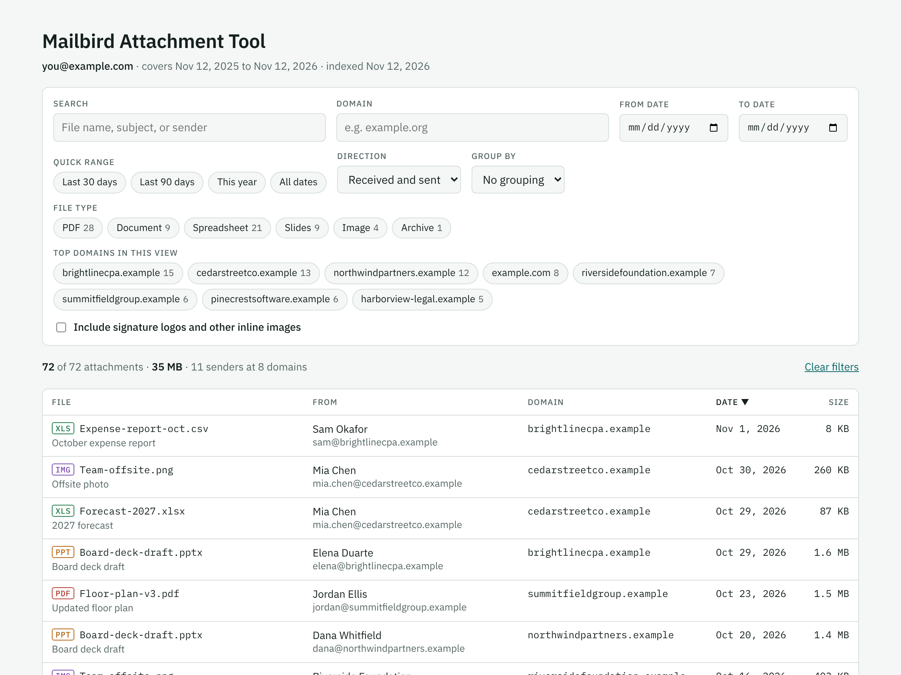
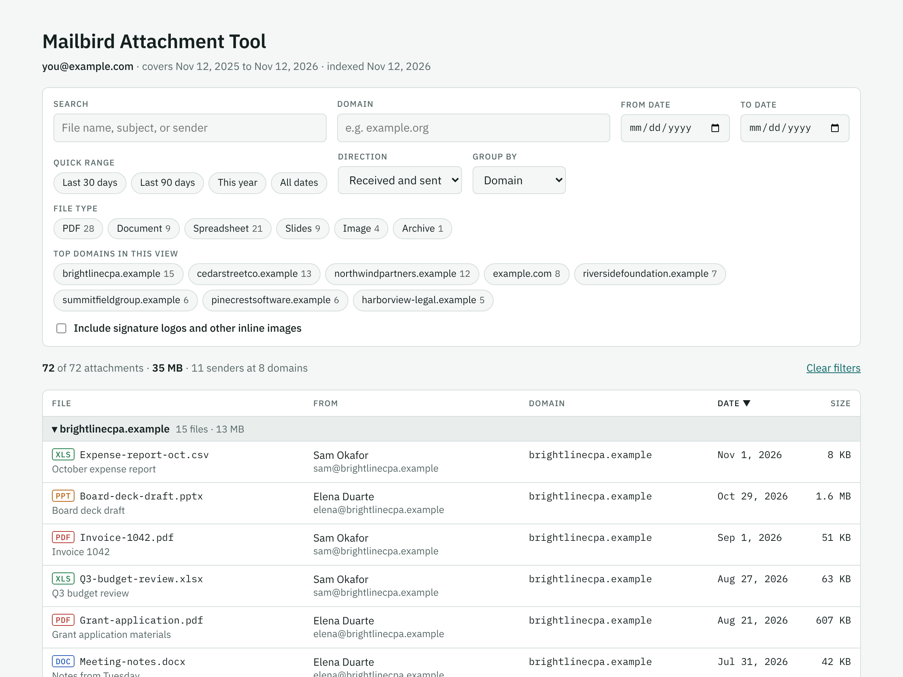

# Mailbird Attachment Tool

A Claude skill that rebuilds the old Mailbird "all attachments" view. It reads your mailbox through Mailbird's MCP tools, then publishes a private, searchable page of every attachment you have received or sent.

- Search by file name, subject or sender
- Filter by **domain**, date range, direction (received or sent) and file type
- Group by domain or sender
- Sort by file, sender, domain, date or size
- **Open email in Mailbird** (new window) and **Save file** buttons on each row
- Signature logos and other small inline images are hidden behind a toggle

The screenshots use invented data.

## What you need

- Mailbird with its AI / MCP connection turned on
- Claude with skills and artifacts available
- The **Claude desktop app, with Mailbird running**, if you want the Open email and Save file buttons. Without it the page still works as a searchable index.

## Install

1. Download this repository (Code > Download ZIP) or clone it.
2. Zip the `mailbird-attachment-tool` folder itself, so the archive's top level is that folder and `SKILL.md` sits inside it.
3. In Claude, open Customize > Skills and upload the ZIP, then turn the skill on. Anthropic's guide to packaging and uploading skills: https://claude.com/docs/skills/how-to
4. In Claude Code, copy the folder to `~/.claude/skills/mailbird-attachment-tool/` instead.

Skill availability depends on your Claude plan and settings.

## Use

Ask Claude something like: *"Build my Mailbird attachment index for the past year for my work account."* Claude asks which account and date range, collects the attachments, and publishes the page. The first time you click a button, the Claude app asks permission to use Mailbird.

## What it does with your mail

- Every Mailbird call is read-only. It never sends, moves, deletes or archives anything.
- The index lists sender names, addresses, subjects and file names. It is published as a private page that only you can open until you choose to share it.
- Nothing from your mailbox is stored in this repository. Do not commit your own `attachments.json`.
- The skill contains page code that runs inside Claude. Read `mailbird-attachment-tool/SKILL.md` and `assets/index.html` before you use it.

## Known limits

- Mailbird search returns at most 100 conversations per query, so the skill searches in small date windows and checks its work with an independent recount.
- Some conversations Mailbird cannot read; the skill reports them.
- The signature-logo filter is a heuristic based on file name and size.
- The index is a snapshot. Ask Claude to refresh it, or schedule a refresh.
- Save works for common file types up to 10 MB. Other files can be opened from the email.

## License

MIT. See [LICENSE](LICENSE).
